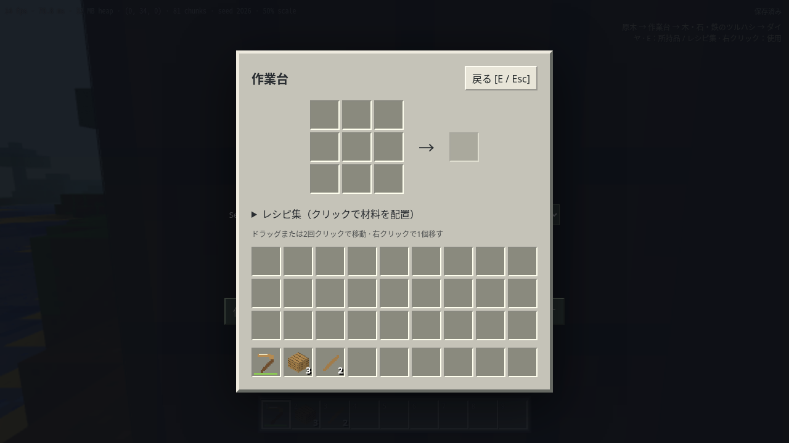

# Classic Voxel Survival

昔の Minecraft を参考にした、PC ブラウザ向けのシングルプレイ・ボクセルゲームです。
Three.js + TypeScript + Vite。GitHub Pages で配信でき、ゲーム用サーバーは不要です。
公式 Minecraft の素材は同梱せず、テクスチャ・アイコン・モデルを手続き生成します。

**[ブラウザで遊ぶ](https://temesotejam.github.io/2026_10_24_2/)** · [三人称・字幕付きプレイ動画をダウンロード](https://github.com/temesotejam/2026_10_24_2/raw/refs/heads/main/public/watch/survival-steady-camera.mp4) · [サバイバル討伐動画の記録](docs/PLAYTHROUGH.md)



## 遊び方

最初はサバイバルモードで、所持品ゼロから始まります。

1. 木を左クリック長押しで採取し、落ちた原木を近づいて回収。
2. **E** の所持品画面でレシピ集を開き、木材・棒・作業台を作成。
3. 作業台を設置して右クリックで開き、木のツルハシを作成。
4. 石から丸石を集め、石のツルハシとかまどを作成。
5. 石炭と鉄鉱石を採掘し、かまどで鉄を精錬。
6. 鉄のツルハシを作り、地下のダイヤ鉱石を探す。

所持品はドラッグまたは2回クリックで移動できます。移動元を選択してから移動先を
右クリックすると1個だけ移します。レシピ集は、材料があればクラフト枠へ自動配置します。
完成品の枠をクリックすると作成できます。

| 操作                         | キー                       |
| ---------------------------- | -------------------------- |
| 移動 / 視点                  | WASD / マウス              |
| ジャンプ / 水中で浮上        | Space                      |
| ダッシュ / しゃがみ          | Ctrl / Shift               |
| 採掘・攻撃                   | 左クリック（採掘は長押し） |
| 設置・食べる・使用           | 右クリック                 |
| 所持品 / 閉じる              | E                          |
| ホットバー選択               | 1〜9 / ホイール            |
| 一人称・後方・前方の視点切替 | F5（WebGL 描画時）         |
| メニュー・操作解除           | Esc                        |
| 詳細情報の表示切替           | F3                         |

しゃがみは視点を下げ、地上で端から落ちることを防ぎます。当たり判定の高さは変わりません。
体力・空腹・呼吸があり、落下、溺水、窒息、溶岩、敵からダメージを受けます。
空腹が十分なら体力が回復します。死亡すると所持品を落とし、復活できます。

昼は豚・牛・羊・鶏、夜は独自モデルの敵が出現します。剣で戦い、食料や羊毛を採取できます。
小麦・種で動物を繁殖させられます。クワで耕した土に種を植えると約3分で小麦が成長し、
苗木は約4分で成長します。夜はベッドを使って朝にでき、復活地点を設定できます。
近くに敵がいると眠れません。昼夜は20分周期です。

## ワールドと保存

メニューで Seed とモードを選び「ワールドを開く」で切り替えます。
同じ Seed・モードなら続きから再開します。URL にも指定できます。

- `?seed=2026&mode=survival`：通常プレイ
- `?seed=2026&mode=creative`：ブロックを消費せず建築。E で全アイテムを取得可能

位置、視点、所持品、体力・空腹、時刻、チェスト、かまど、生物、落下アイテム、
農作物・流体の状態、地形の変更差分を **IndexedDB** に15秒ごとに保存します。
Esc メニューで手動保存・JSON バックアップ書き出し・読み込み・前回の保存への復元ができます。
保存は Seed とモードごとに分離し、直前の保存も1世代保持します。
ブラウザのデータ消去や別オリジンへの移動ではデータを引き継げないため、バックアップを利用してください。
ブラウザを閉じる直前の未保存分まで保持される保証はありません。
保存不可・容量不足の場合は画面に通知し、既存の保存を保持します。

## 開発・検証

Node.js 24 を使用します。

```sh
npm ci
npm run dev -- --host 0.0.0.0
```

```sh
npm run lint
npm run format
npm test
npm run build:pages
npm run preview -- --host 127.0.0.1 --port 4173 --strictPort --base /2026_10_24_2/
# 別ターミナルで実行
node scripts/visual-check.mjs --url http://127.0.0.1:4173/2026_10_24_2/
node scripts/survival-check.mjs --url http://127.0.0.1:4173/2026_10_24_2/
node scripts/journey-check.mjs --url http://127.0.0.1:4173/2026_10_24_2/
node scripts/polish-check.mjs --url http://127.0.0.1:4173/2026_10_24_2/
node scripts/load-check.mjs --url http://127.0.0.1:4173/2026_10_24_2/
node scripts/explore-check.mjs --url http://127.0.0.1:4173/2026_10_24_2/ --distance 256
node scripts/performance-check.mjs --url http://127.0.0.1:4173/2026_10_24_2/ --seconds 20
```

Puppeteer の Chromium を使用します。システム Chromium がある場合は、インストール時に
`PUPPETEER_SKIP_DOWNLOAD=true npm ci`、ブラウザ検証時に
`PUPPETEER_EXECUTABLE_PATH=/usr/bin/chromium` を指定できます。
描画付き長時間試験は、公開後に Actions の **Published world stability** から実行できます。
既定の7200秒で実時間2時間、移動・ジャンプ・採掘を続け、5分ごとに保存と再読込を照合します。
最初の30分も途中経過として記録し、結果JSONと画像をArtifactsへ保存します。
ローカルで短い動作確認をする場合は次のコマンドを使います。

```sh
node scripts/soak-check.mjs --url http://127.0.0.1:4173/2026_10_24_2/ --seconds 70 --reload-seconds 30
```

スクリーンショット・計測値・テスト用バックアップは Git 対象外の `visual-check/` に生成します。
性能計測は他のブラウザ検証と同時に走らせず、同じ端末・解像度・描画設定で比較してください。

## 公開

`.github/workflows/ci.yml` はブランチへの push と PR で、静的検査・単体テスト・Pages ビルド・
ブラウザ操作・保存検証を行います。main が検査を通過した場合のみ Pages をデプロイします。
GitHub Settings → Pages の Source を **GitHub Actions** に設定する必要があります。
機能ブランチへの push は公開を行いません。

## 実装範囲と残る評価

基本サバイバルをGitHub Pagesで公開しています。Minecraft と同一仕様ではありません。
視界は4〜12チャンクで調整でき、描画解像度は自動または25〜100%の手動指定を選べます。
F3またはメニューの「詳細情報」でFPS・平均フレーム時間・チャンク数を表示できます。
メニューで効果音を切り替えられ、音と情報表示の設定はブラウザに保持します。
足音・破壊音・設置音は独自合成し、採掘片を追加しています。
松明・日光はプレイヤー周辺の32ブロック立方領域で伝播計算します。
流体は近くの変更から処理数を制限して広げる簡易方式で、完全な流体シミュレーションではありません。
CPU 代替描画ではモデル・照明を簡略化し、三人称視点を無効にしています。

自然の木からダイヤ採掘、松明設置、保存と再読込までを実際のブラウザ操作で検証します。
実機での操作感比較、低スペック PC の30 FPS / 標準 PC の60 FPSは未評価です。
描画付き2時間試験の結果と公開検証の記録は進捗資料に記載します。
村・遺跡・釣り・エンチャント・醸造・ネザー・雨雪・湿地を追加しています。追加依頼により、エンドとエンダードラゴンも実装しています。
追加地形を探索する場合は未使用Seedで新規ワールドを作成してください。旧セーブは従来の地形を維持します。
遊び方と原版との仕様差は [計画との差分](docs/PLAN-AUDIT.md) と所持品画面の「冒険ガイド」に記載しています。
詳しくは [進捗と検証記録](docs/STATUS.md) を参照してください。

## 出典

- [開発計画](docs/PLAN.md)
- [基盤の導入記録](docs/BASELINE.md)
- [初期の操作改善](docs/M1-CONTROLS.md)
- [公式Classicを操作した比較と改善](docs/CLASSIC-COMPARISON.md)
- [上流の説明](docs/UPSTREAM.md)

基盤は [Vincent-P-essy/minecraft-clone](https://github.com/Vincent-P-essy/minecraft-clone)、
MIT License。取得時コミットは `6766703c14f7a443d94983600528614cc931df89`。
元の著作権表示と [LICENSE](LICENSE) を保持しています。
Mojang / Microsoft の公式製品ではありません。

### 三人称で見る

WebGL版は **F5** で一人称・背後・正面を切り替えられます。[背後視点で始める](https://temesotejam.github.io/2026_10_24_2/?seed=20261025&mode=survival&view=third-person)。壁際ではカメラが近づき、狭い坑道では一人称に近い映像になります。参考資料・検証内容は [三人称カメラ](docs/THIRD-PERSON.md) を参照してください。

[三人称・字幕付きの討伐動画をダウンロード（MP4・約19MB）](https://github.com/temesotejam/2026_10_24_2/raw/refs/heads/main/public/watch/survival-steady-camera.mp4)。所持品ゼロから討伐・帰還まで、約1.5倍速・10分13秒です。
