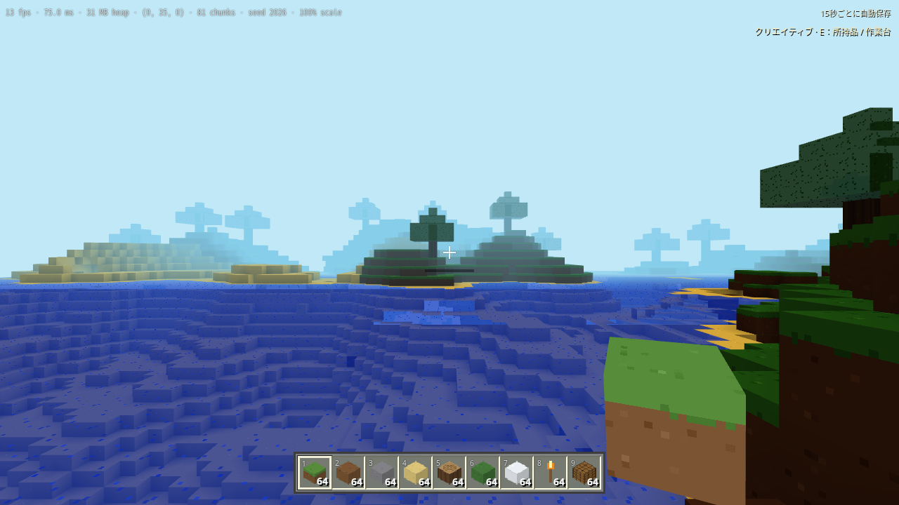
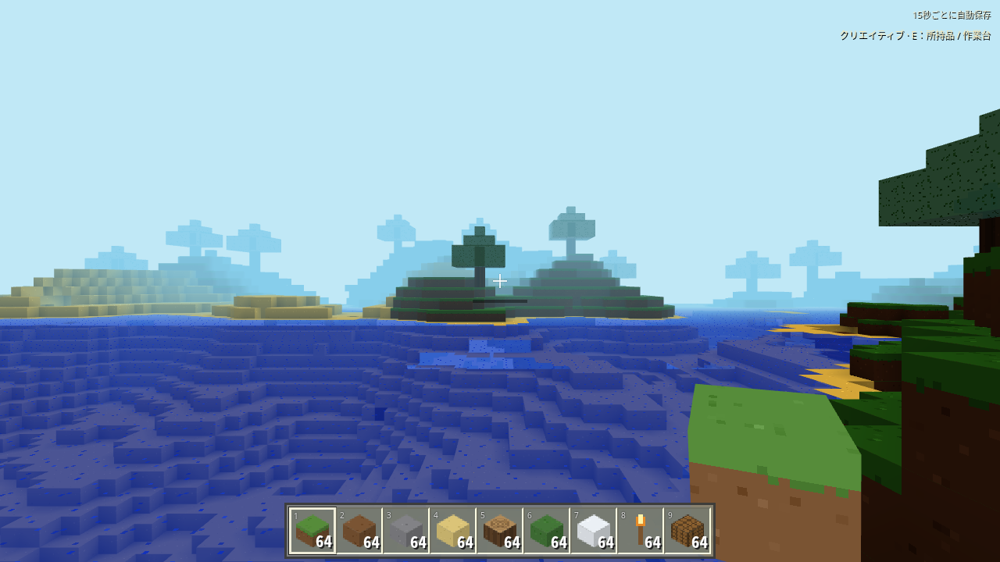

# 公式Minecraft Classicとの操作比較

2026年10月25日（日本時間）。比較対象は [公式Minecraft Classic](https://classic.minecraft.net/) の画面に `0.0.23a_01` と表示されたブラウザ版。
自動ブラウザで歩行・ジャンプ・ブロック破壊・建築モード切替・設置・ブロック選択・Escメニュー・Optionsを操作した。
位置、画角、対象ブロックの状態は公開されたエンジンの状態を読み取り、変更はキーとマウスで行った。
破壊対象が空気へ変わり、設置先の空気が選択したブロックへ変わることも確認した。

## 比較結果と反映した改善

| 項目             | 公式Classicで確認した状態                           | 当ゲームの変更前 → 変更後                                                                 |
| ---------------- | --------------------------------------------------- | ----------------------------------------------------------------------------------------- |
| 縦画角           | 70度                                                | 75度 → WebGL/CPUとも70度                                                                  |
| ホットバー幅     | 1280×720で552px                                     | 同じ解像度で444px → 552px。16pxアイコンを整数倍率で表示                                   |
| 縮小画面のバー   | 640×480で368px                                      | 画面に応じた段階的な倍率を追加。タッチ画面は専用サイズを使用                              |
| 性能情報         | OptionsのShow FPSは初期OFF                          | 常時表示 → 初期OFF。F3とメニューで切替、設定を保持                                        |
| 採掘片           | 壊した場所からブロック片が出る                      | 破壊1回につき独自の粒子12個。最大128個、寿命0.45〜0.75秒、描画1回に集約                   |
| 効果音           | Soundは初期ON。草・石・木などの音源の読み込みを確認 | 独自合成の足音・破壊音・設置音を追加。材質3種、同時発音最大8、音バッファ最大9種           |
| ミュート         | OptionsのSoundで切替                                | メニューに効果音の切替を追加。再読込後も保持                                              |
| クリックの正確さ | 120msの押下で指定ブロックを1個破壊できた            | 短い押下中の次フレームにもう1個壊れる場合があったため修正。単押しは1個、長押しは200ms間隔 |

200msは当ゲームの長押し用に選んだ間隔で、公式版の反復間隔を測定した値ではない。
目の高さは両方とも1.62ブロックだった。ジャンプの描画サンプルは原版約1.27、当ゲーム約1.20ブロックで、サンプル間隔や地形が異なるため速度・物理の優劣は判定していない。
当ゲームのサバイバル向け操作と固定120 Hz物理は継続し、入力・衝突・進行は既存テストでも確認する。

## 同条件の変更前後

当ゲームを同じSeed 2026、位置 `(0.5, 35, 0.5)`、視点角0、1280×720、描画倍率100%で撮影。
原版とは地形が異なるため、原版の風景とのピクセル一致を評価する画像ではない。

| 変更前                                           | 変更後                                          |
| ------------------------------------------------ | ----------------------------------------------- |
|  |  |

## 検証

- 単体・統合テスト340件。音の波形が有限・非クリップ・両端無音であること、材質別の違い、足音の距離間隔・空中/しゃがみ/停止時の抑制、粒子数上限と寿命・床との接触を追加検証。
- `scripts/polish-check.mjs`：画角、4画面サイズのホットバー、F3、描画された採掘片の生成と消滅、Web Audio出力の正の波形値、単押し1ブロック、ミュート、設定の再読込をブラウザで確認。
- `scripts/explore-check.mjs`：通常入力による架橋・採掘・チャンク跨ぎと保存復元に加え、帰路の歩行で足音が出ることも検証。
- ローカルビルドとデプロイ後の公開HTTPSの両方でpolish-checkを実行するCIを追加。

測定値は [classic-comparison-results.json](classic-comparison-results.json) に保存。音と粒子・アイコンは独自生成。
Classicは建築中心の版なので、クラフト・精錬・食料・戦闘・農業の進行は別のサバイバル検証で確認する。
人が手で操作した際の感触、音色の好み、実機の30/60 FPSは未評価。従来の2時間連続試験は初期公開版の記録で、今回の効果追加後の2時間試験とはしていない。
