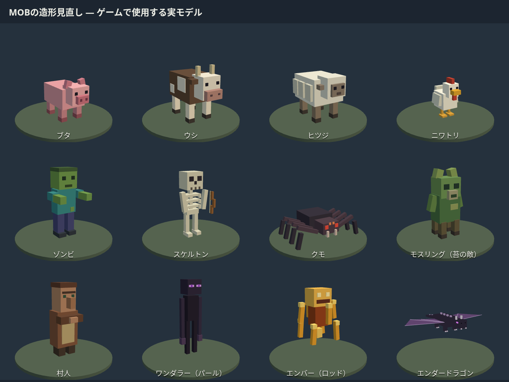

# MOBの見分け方

2026年10月31日に、共通の人型だった敵を含む通常MOB11種とドラゴンの造形を見直しました。顔だけでなく、輪郭・姿勢・装備・配色で区別できます。

| 種類             | 見た目の目印                                                 |
| ---------------- | ------------------------------------------------------------ |
| ブタ             | 桃色の体、大きな鼻と鼻孔、立った耳、短いしっぽ               |
| ウシ             | 角、白い斑模様、幅広い口、ひづめと長いしっぽ                 |
| ヒツジ           | 厚い羊毛、毛束の段差、小さい茶色の顔と耳                     |
| ニワトリ         | 白い羽、赤い鶏冠、黄色いくちばし、翼と広がった足先           |
| ゾンビ           | 緑の肌、青緑の服、紫のズボン、前へ伸ばした両腕               |
| スケルトン       | 穴のある頭骨、肋骨、細い手足、弓と弦                         |
| クモ             | 低く広い胴体、折れた8本の脚、赤い複眼と牙                    |
| モスリング       | 苔色の体、葉の冠、石色の鼻、4本の根のような脚                |
| 村人             | 大きな鼻、太い眉、組んだ腕、茶色の服と前掛け                 |
| ワンダラー       | 背が高く細い体、長い腕と脚、紫色の目。パールを落とす敵       |
| エンバー         | 足のない炎の芯、周囲の金色のロッド。ロッドを落とすネザーの敵 |
| エンダードラゴン | 角、背びれ、爪、紫色の目と骨組みのある大きな翼               |

通常MOBは細部の直方体を頂点カラー付きの単一ジオメトリへ結合し、1体1回の描画にしています。画像素材は追加せず手続き生成しています。この更新は外見の変更で、戦闘能力・ドロップ・保存形式は変更していません。以前公開した録画には更新前のモデルが映っています。

モデル一覧は、開発サーバーを起動後に `node scripts/mob-model-check.mjs http://127.0.0.1:4177` で撮影できます。実際のゲームと同じモデル生成関数を読み込み、全種の描画・有限な頂点範囲・描画回数を確認します。開発サーバーは `npm run dev -- --host 127.0.0.1 --port 4177` で起動します。

検証では12種類のモデルをブラウザーで描画し、一覧画像を確認しました。`npm run lint`、`npm run build:pages`、変更ファイルの整形チェックと、`scripts/combat-check.mjs` によるゲーム内の近接・射撃・退避など10項目のチェックが通っています。
