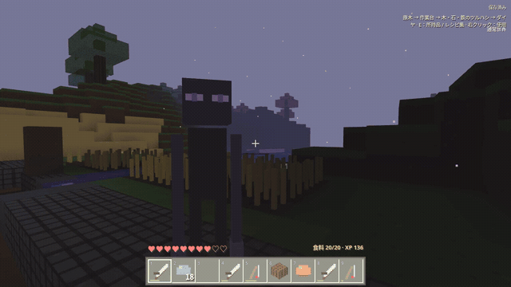

# MOBの見分け方

2026年10月31日に、共通の人型だった敵を含む通常MOB11種とドラゴンの造形を見直しました。顔だけでなく、輪郭・姿勢・装備・配色で区別できます。

| 種類             | 見た目の目印                                                 |
| ---------------- | ------------------------------------------------------------ |
| ブタ             | 桃色の体、大きな鼻と鼻孔、立った耳、短いしっぽ               |
| ウシ             | 角、白い斑模様、幅広い口、ひづめと長いしっぽ                 |
| ヒツジ           | 厚い羊毛、毛束の段差、小さい茶色の顔と耳                     |
| ニワトリ         | 白い羽、赤い鶏冠、黄色いくちばし、翼と広がった足先           |
| ゾンビ           | 緑の肌、青緑の服、紫のズボン、前へ伸ばした両腕               |
| スケルトン       | 穴のある頭骨、肋骨、細い手足、弓と弦                         |
| クモ             | 低く広い胴体、折れた8本の脚、赤い複眼と牙                    |
| モスリング       | 苔色の体、葉の冠、石色の鼻、4本の根のような脚                |
| 村人             | 大きな鼻、太い眉、組んだ腕、茶色の服と前掛け                 |
| ワンダラー       | 背が高く細い体、長い腕と脚、紫色の目。パールを落とす敵       |
| エンバー         | 足のない炎の芯、周囲の金色のロッド。ロッドを落とすネザーの敵 |
| エンダードラゴン | 角、背びれ、爪、紫色の目と骨組みのある大きな翼               |

## 実プレイのループ映像

GitHubのこのページ内で自動ループする、本編からの短い抜粋です。[約30分12秒の全編をダウンロードせず連続再生する](https://temesotejam.github.io/2026_10_24_2/watch/survival-30min.html) / [各章と記録](../downloads/survival-30min/README.md)。日本語字幕・三人称・720pで、所持品ゼロからドラゴン討伐・卵の持ち帰りまで進めています。

## 特殊能力・行動の違い

比較の基準は、**サバイバルの素のプレイヤー（装備・道具・ポーションなし、最大HP20、素手の攻撃力1）**です。そこから大きく異なる攻撃・移動・耐久・回復を特殊能力として記載します。装備由来の攻撃はその旨を明記し、外見・ドロップ・敵対条件は補足として分けています。以下は現在の実装で、公式Minecraftの能力をそのまま表すものではありません。

| 種類             | 特殊能力・大きな差                                                                                                                          | その他の特徴・弱点                                                                                                                                         |
| ---------------- | ------------------------------------------------------------------------------------------------------------------------------------------- | ---------------------------------------------------------------------------------------------------------------------------------------------------------- |
| ブタ             | 固有の特殊能力なし                                                                                                                          | 小麦で繁殖。倒すと生肉を落とす                                                                                                                             |
| ウシ             | 固有の特殊能力なし                                                                                                                          | 小麦で繁殖。生肉の量が多い。搾乳は未実装                                                                                                                   |
| ヒツジ           | 固有の特殊能力なし                                                                                                                          | 小麦で繁殖。倒すと羊毛も落とす。毛刈りは未実装                                                                                                             |
| ニワトリ         | 固有の特殊能力なし                                                                                                                          | 種で繁殖。羽根を落とすことがある。飛行・滑空・産卵は未実装                                                                                                 |
| ゾンビ           | **近接攻撃力3（素手の3倍）**                                                                                                                | 空の開けた昼間は毎秒2HP減る。感染能力は未実装                                                                                                              |
| スケルトン       | **弓による遠距離攻撃〔装備由来〕**。距離14ブロック未満から約2.5秒間隔で射撃し、命中すると3ダメージ                                          | 接近されると後退して距離を取る。壁で射線を遮れる。昼の日光に弱い                                                                                           |
| クモ             | 固有の特殊能力なし（近接攻撃力2）                                                                                                           | 低く広い外見だが、壁登り・毒・糸による拘束は未実装                                                                                                         |
| モスリング       | **自爆・地形破壊**。距離1.8ブロック未満で約1.5秒ためて爆発。プレイヤーに8ダメージ（最大HPの40％）、周囲の壊せるブロックも破壊し、自身は死亡 | 離れると起爆の蓄積が減る。射線を遮ると起爆の進行を止められる                                                                                               |
| 村人             | 戦闘の特殊能力なし。**取引機能**あり                                                                                                        | 小麦20個または生魚6匹をエメラルド1個と交換、エメラルド1個をパン6個と交換。攻撃してこない                                                                   |
| ワンダラー       | 固有の特殊能力なし（怒った後の近接攻撃力3）                                                                                                 | 攻撃されると敵対する。受動状態では睡眠を妨げない。瞬間移動・ブロック運搬・見つめるだけでの敵対は未実装。パールのドロップは能力とは別の報酬                 |
| エンバー         | 固有の特殊能力なし（近接攻撃力3）                                                                                                           | ロッドが浮いたように見えるのは造形。移動は通常MOBと同じ重力・衝突処理で、飛行・火球・着火攻撃は未実装                                                      |
| エンダードラゴン | **飛行、最大HP200（プレイヤーの10倍）、クリスタルによる回復**。残存クリスタル1個につき毎秒2HP、6個なら毎秒12HP回復                          | 飛行と中央への着地を繰り返す。近くにいると約2秒間隔で3ダメージを受けるが、固体ブロックで遮れる。クリスタルを全破壊すると回復が止まる。ブレス・火球は未実装 |

### 通常MOBに共通する、プレイヤーとの違い

現在の通常MOB11種には、プレイヤー用の空腹・酸素・環境ダメージの処理を適用していません。そのため**飢餓・溺水・窒息・落下・溶岩ではHPが減らない**という共通仕様があります。奈落への落下では死亡し、ゾンビとスケルトンには別途日光ダメージがあります。これは種固有の耐性ではなく、現行実装に共通する差です。

通常の敵は初期HP16、動物と村人はHP8です。いずれも素のプレイヤーより高耐久ではありません。重力、地形との衝突、水中移動、段差でのジャンプはプレイヤーと共通の物理処理を使うため、それだけでは特殊能力として数えません。

実装の確認箇所：[通常MOBの移動・ドロップ](../src/entities/creatures.ts)、[攻撃・自爆・繁殖・日光ダメージ](../src/survival/session.ts)、[ドラゴンの回復と攻撃](../src/survival/adventure.ts)、[飛行経路と最大HP](../src/survival/dragon.ts)、[取引内容](../src/items/trades.ts)、[素手の攻撃力](../src/survival/melee-damage.ts)、[プレイヤーのHPと環境ダメージ](../src/survival/vitals.ts)。

## 改善の反復検証

造形と操作の整合性、段差移動、昼夜と死亡時の処理を3回に分けて検証し、攻撃判定のずれ・後退中の引っ掛かり・死亡後の行動を修正しました。[再現内容と検証結果](MOB-ITERATIONS.md)を記録しています。

## モデルの実装と確認

通常MOBは細部の直方体を頂点カラー付きの単一ジオメトリへ結合し、1体1回の描画にしています。画像素材は追加せず手続き生成しています。造形の更新では戦闘能力・ドロップ・保存形式は変更していません。その後の反復検証で、攻撃・給餌・矢の判定を種類と子供の体格に合わせ、移動と死亡時の不具合を修正しました。以前公開した録画には更新前のモデルが映っています。

モデル一覧は、開発サーバーを起動後に `node scripts/mob-model-check.mjs http://127.0.0.1:4177` で撮影できます。実際のゲームと同じモデル生成関数を読み込み、全種の描画・有限な頂点範囲・描画回数を確認します。開発サーバーは `npm run dev -- --host 127.0.0.1 --port 4177` で起動します。

検証では12種類のモデルをブラウザーで描画し、一覧画像を確認しました。`npm run lint`、`npm run build:pages`、変更ファイルの整形チェックと、`scripts/combat-check.mjs` によるゲーム内の近接・射撃・退避など10項目のチェックが通っています。
