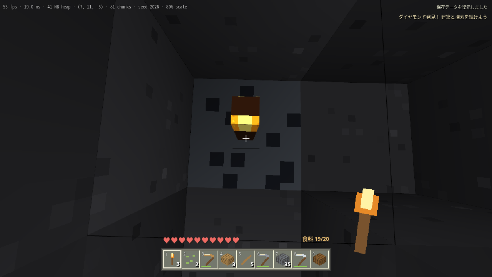

# 基本サバイバル統合版の進捗

2026年10月25日（日本時間）。[公開ゲーム](https://temesotejam.github.io/2026_10_24_2/)。
基本サバイバルの実装と最終調整をmainへ統合済み。[公開タグ v0.1.0-beta.1](https://github.com/temesotejam/2026_10_24_2/releases/tag/v0.1.0-beta.1)。自動検証の数値は [validation-results.json](validation-results.json) に記録。

## 追加した機能

| 領域           | 実装                                                                                                                                 |
| -------------- | ------------------------------------------------------------------------------------------------------------------------------------ |
| 操作・見た目   | Ctrl ダッシュ、Shift しゃがみ、固定120 Hz物理、歩行約4.317ブロック/秒、ジャンプ約1.25ブロック、F5視点切替、独自ピクセルアイコンとHUD |
| 地形           | Seedベースの洞窟・森林・砂漠・雪山・海、オークとシラカバ、石炭・鉄・金・ダイヤ鉱石                                                   |
| 採取・建築     | 採掘時間、適正道具、採掘ティア、耐久、ドロップ・回収、有限の設置、クリエイティブ                                                     |
| 所持品         | 36スロット、9枠ホットバー、スタック、ドラッグ・クリック移動、1個移動                                                                 |
| クラフト       | 2×2と3×3、形と鏡映の判定、データ化したレシピ、材料の自動配置、出力容量の確認                                                         |
| 作業用ブロック | 作業台、燃料・精錬を進めるかまど、27枠チェスト、ベッド・睡眠・復活地点                                                               |
| 生存           | 体力、空腹、食事、自然回復、落下・溺水・窒息・溶岩ダメージ、死亡・所持品落下・復活                                                   |
| 農業           | クワ・耕地・種・小麦・パン、苗木の成長、動物の繁殖                                                                                   |
| 生物・戦闘     | 豚・牛・羊・鶏、追跡と近接攻撃、スケルトンの矢、接近して爆発する独自の敵、クモ、剣・攻撃間隔・戦利品                                 |
| 光・水         | 局所の日光と松明の伝播・遮蔽、変化時の再計算、処理数・距離を制限した水と溶岩、接触時の丸石化                                         |
| 保存           | IndexedDB、Seed+差分と全プレイ状態、15秒自動保存、1世代前の保持、検証付きJSON入出力、保存失敗の表示                                  |
| 軽量化         | 既存のWorkerとGreedy Meshing、4チャンクの初期視界、設定変更、距離別の生物更新、局所光と流体の更新予算                                |

## 自動検証

- 30ファイル、383件の単体・統合テスト。
- 空の所持品から原木 → 木材・棒・作業台 → 木と石のツルハシ → 鉄の精錬 → 鉄のツルハシ → ダイヤ取得の進行。
- スタックと移動の数量保存、満杯時のクラフト中断、全レシピ、道具の採掘ティアと耐久。
- 食事・呼吸・ダメージ・回復、成長・繁殖、戦闘、矢の遮蔽、ベッドと復活地点。
- 松明の伝播と壁による遮蔽、簡易流体の範囲制限、Seedと鉱石深度、松明の狭い形状。
- 2時間分の状態更新と120回のJSON検証・復元。描画付き長時間プレイの代替ではない。
- 型検査、ESLint、Prettier、Pagesビルド。

ブラウザハーネスは次の8種類です。

1. `scripts/visual-check.mjs`：クリエイティブで描画、歩行、採掘、設置、しゃがみ、マウス固定の代替動作、CPU描画、タッチ操作を検証（27項目）。
2. `scripts/survival-check.mjs`：空の所持品からの採掘・回収、所持品、保存・再読込、バックアップ、作業台設置と道具作成、書き込み失敗時の旧保存保持を検証（18項目）。クラフトUIだけの検証には原木を含む明示的なテスト用保存データを使用する。
3. `scripts/journey-check.mjs`：通常のサバイバルで自然の木から原木・木材・道具・丸石・鉄精錬・ダイヤ採掘・松明設置まで進め、照明の画素輝度と保存再読込後の所持品・体力・松明を確認。地形と鉱石の調査・状態照合には読み取り専用デバッグAPIを使い、移動・採掘・橋の設置・作成はキー、マウス、UIを操作。所持品注入・テレポート・時刻変更は使わない。
4. `scripts/load-check.mjs`：人工の負荷用バックアップをUIから読み込み、101,734セルの変更差分、10,000個の落下アイテム、満杯の所持品で約18秒の描画付き動作と保存・3回の再読込を確認。差分・アイテム数・所持品が保持され、チャンク数81、JSヒープ最大約106 MBだった。通常プレイでこの量を採掘した試験ではない。
5. `scripts/explore-check.mjs`：クリエイティブの通常入力で地形を掘り、必要な場所に橋を作ってチャンク境界を越え、保存再読込後に歩いて戻り、再ストリームされた変更を照合。CIでは32ブロック往復、ローカルでは256ブロック先で保存再読込後、歩いて戻る合計512ブロックの検証にも合格。ワールド変更APIやテレポートは使わない。
6. `scripts/polish-check.mjs`：Classic比較に基づく画角、4画面サイズのHUD、F3、単押し1ブロック、粒子、Web Audio出力、ミュートと設定保持を検証。

7. `scripts/adventure-check.mjs`：明示的なテスト用バックアップで釣り・エンチャント・醸造・回復・ネザー往復・遺跡ゲート・弓によるクリスタル破壊・サバイバルのボス討伐・報酬と再読込を検証。所持品ゼロからの動画とは別の試験。

8. `scripts/combat-check.mjs`：明示した検証用ワールドで近接・遠距離の敵に対応し、クラフトと移動を中断・再開することを検証。戦闘判断は別途5件のポリシーテストでも確認。実装の参考元は [操作ボットの参考資料](BOT-REFERENCES.md) を参照。

`performance-check.mjs` は固定Seed・1280×720・視界4で起動時間、FPS、フレーム時間中央値と95パーセンタイル、メモリ、チャンク数をJSONに出力します。SwiftShader上の測定は、標準・低性能PCの性能保証には使いません。

## 公開と長時間検証

- PR #1〜#4をmainへ取り込み、Pagesで基本サバイバル版を公開。
- デプロイ後に公開HTTPSサイトを通常のTLS検証で開き、描画・採掘・保存の45項目を確認するCIを追加。
- [実時間2時間の描画付き試験](https://github.com/temesotejam/2026_10_24_2/actions/runs/40108197148) は7,201.5秒（2時間）、保存再読込23回、採掘15回で成功。119チェックポイントでJSヒープ最大73.5 MB、チャンク数最大90だった。[集計ワークフロー](https://github.com/temesotejam/2026_10_24_2/actions/runs/40117370814) にも記録。クリエイティブで移動・ジャンプの入力と採掘を行い、5分ごとに保存と再読込を照合した。人によるサバイバル2時間プレイとは異なる。地形で水平移動が止まる場合があるため、長距離移動の保証には別の往復ハーネスを使う。
- 最新の長時間ハーネスは操作モード、WebGLコンテキスト、時計の進行も確認する。更新版はローカルPagesビルドで実時間1,803秒（30分）・保存再読込5回・採掘20回の試験に合格。30チェックポイントで操作継続、コンテキスト保持、時計の進行を確認し、JSヒープ最大42.8 MB、チャンク数最大90だった。上記2時間試験は初期公開ゲームと更新前のハーネスを使用した。
- 自動解像度調整を改善し、メニューに25〜100%の手動選択も追加。1280×720、視界4、3種Seed各20秒のSwiftShader測定で平均約19.5から約26.2 FPSへ改善。標準PCの実測値ではない。
- 松明や草ブロック側面の上下逆のUVを修正。手持ちブロックの面別テクスチャ、道具の独自アイコン、太陽と月を追加。昼の動物で上限が埋まると夜の敵が出現しなくなる不具合を修正し、回帰テストを追加。

## Classic比較による調整

公式Classicを自動ブラウザで直接操作して、画角・ホットバー・情報表示・採掘反応を比較した。画角70度、段階的なHUD倍率、F3、独自合成音、採掘片、クリエイティブ単押しの二重採掘防止を実装。比較範囲と測定値は [比較記録](CLASSIC-COMPARISON.md) を参照。

## 実機・参照評価

- Beta 1.7.3相当の参照映像との視覚比較と、人が操作した際の操作感の調整。
- 実機で評価端末・解像度・視界を固定した30/60 FPSと初期読込5秒の判定。
- 大量アイテムは人工データで検証済みだが、実機負荷は未評価。

基本サバイバル（P0/P1）の実装・自動総合検証・公開は完了。M7で想定した実機性能と参照映像による評価は未実施です。
P2の村・構造物・釣り・エンチャント・ポーション・ネザー・天候・湿地を追加実装しています。追加指示により、当初対象外だったエンドとエンダードラゴンも実装。仕様差・旧セーブとの互換性・残る実機評価は [計画との差分](PLAN-AUDIT.md) を参照。初期所持品ゼロからの討伐録画は実施中で、完了記録は別途追加します。

## 現時点の仕様差・制限

- ワールドの高さは基盤の96。Minecraftと同じSeedから同じ地形になる仕様ではない。
- 光の計算領域はプレイヤー周辺32³セル。領域外の遠景は簡略化した照明。
- 流体は下方向優先、水は横4セル、溶岩は横2セル。1回24セル、待ち4096件、保存する流れ10000セルまで。既に流れた水の完全な引き戻しや無限水源は未実装。
- CPU描画は生物を遮蔽付きの簡易表示にし、WebGLと同等の照明・モデルにはしない。
- 生物AIは距離による休止・直接追跡・ジャンプ回避。迷路を解く経路探索は未実装。
- インベントリ中も時間と生物は進む。Escメニューとフォーカス喪失時は停止。
- 農作物は読み込まれたチャンクで成長。遠くの土地を常時更新しない。
- ブラウザを閉じる直前の未保存分は失う場合がある。必要な時は手動保存と書き出しを使う。

## GitHubでの確認

ブランチへのpushで全検査と自然の木からダイヤまでのブラウザ操作を実行する。
mainの検査成功後にPagesをデプロイし、公開URLでもブラウザ検証する。
[初期公開ゲームコードのCI](https://github.com/temesotejam/2026_10_24_2/actions/runs/40116421566) は静的検査・335テスト・ローカルブラウザ検証・デプロイ・公開HTTPS上の45項目すべてに成功。当時の公開JSは `index-BQG-EhK_.js`。
PagesのSourceはGitHub Actions。公開・mainへの取り込みはユーザーの指示に基づき実施済み。

## 通し検証の画面

## クラウド内の描画計測（初期公開版）

1280×720、視界4、各20秒、Chromium / SwiftShader。ブラウザ検証と同時に計測していない。

| Seed       | 初期メッシュ待ち | 平均FPS | 中央フレーム時間 | 95%フレーム時間 |
| ---------- | ---------------- | ------- | ---------------- | --------------- |
| 1          | 1.07秒           | 27.19   | 33.4 ms          | 50.1 ms         |
| 2026       | 1.02秒           | 25.30   | 33.4 ms          | 50.1 ms         |
| -987654321 | 1.03秒           | 26.25   | 33.4 ms          | 50.1 ms         |

チャンク数81、JSヒープ約37〜40 MB。回線を含む初回アクセス5秒の保証や、実機の30/60 FPS判定には使用しない。
