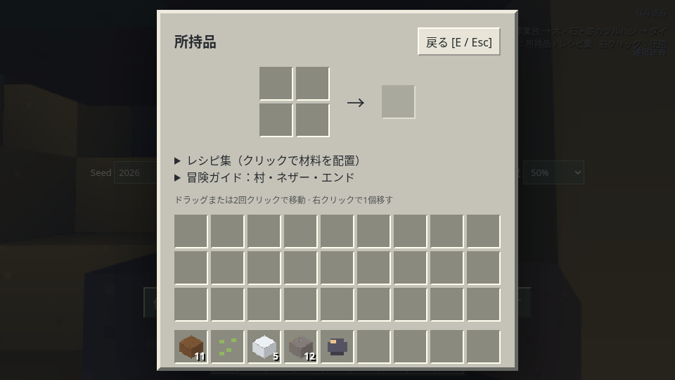
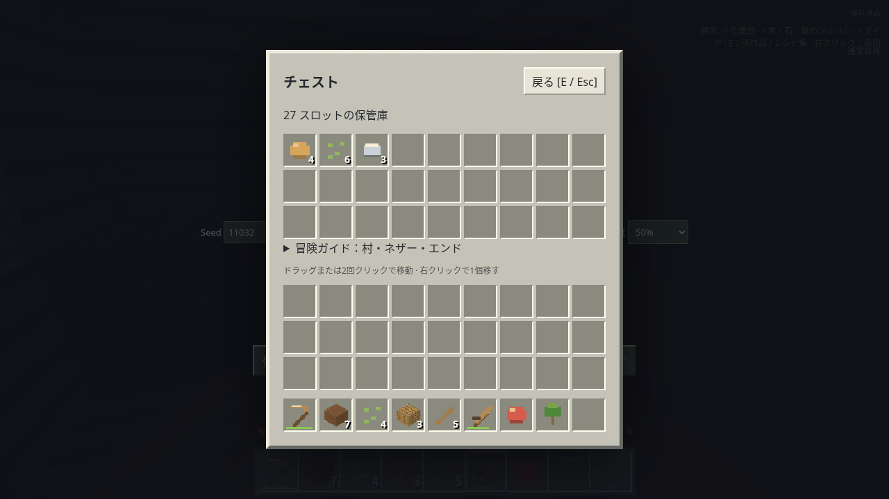

# サバイバル進行の見直し

2026年10月29日。前の討伐動画は「最後まで到達できる近道」を多く用意しており、Minecraftのサバイバルで素材を集めて進む流れから外れていました。ユーザーの指摘を受け、独立した3つのAI担当が通常操作でプレイし、仕様の点検、修正、再プレイを行いました。異なるベンダーやモデルを使ったという意味ではありません。

## 変更した動作

| 問題                                                         | 修正した動作                                                                             | 確認                                                    |
| ------------------------------------------------------------ | ---------------------------------------------------------------------------------------- | ------------------------------------------------------- |
| 全村にほぼ完成したゲート                                     | 新規ワールドの村にはゲートも黒曜石も付属させない                                         | 2Seedの通常プレイで村へ移動して確認、生成試験           |
| 宝箱の内容が毎回攻略用セット                                 | 場所ごとのパン・種・鉄などの変化する内容へ。黒曜石セットを廃止                           | 2つのチェストを実際にUIで開いた                         |
| 丸石から火打石、羊毛から糸、麦と木から本                     | 不正なレシピを削除。火打石は自然の砂利から入手                                           | 修正前にUIで再現、修正後に素手採掘で火打石1個を入手     |
| 矢に羽が要らない                                             | 火打石・棒・羽を必要とし、ニワトリの羽とスケルトンの矢ドロップを追加                     | レシピとドロップ試験。通常プレイで羽の入手までは未確認  |
| 普通の村人から麦だけでパール・鉄を買える                     | 食料用の交換だけにし、パールは敵からの入手へ                                             | 交換・ドロップ試験                                      |
| 麦1株から3個など収量が多すぎる                               | 成熟した麦1個と可変の種                                                                  | ドロップ試験                                            |
| ネザーが初めから巨大な黒曜石台と帰還ゲート付き               | 自然生成から削除。作ったゲートで移動したときにだけ安全な到着ゲートを作る                 | 自然生成試験・移動候補試験・ブラウザ往復試験            |
| 右クリックで瞬時に世界移動し、座標や最後の位置に不自然に戻る | 新規ワールドではゲートに4秒間入り、水平座標8:1で対応するゲートへ。既存の有効な枠は再利用 | 検証用データを用いた実際の点火・歩行・往復、保存試験    |
| エンドの枠が毎回8個埋まっている                              | 各枠をSeedから約10%で初期充填。空き枠すべてにアイが必要                                  | 100Seedの生成試験                                       |
| 遺跡が開始点のすぐ近くで、アイが無料の座標表示装置           | 遺跡を離れた場所へ配置。方角を示し、投げたアイは約20%で壊れる。回数を保存                | 方角・消費・保存試験。投擲は簡易な案内表示              |
| 初期視点が崖に向き、直進しづらい                             | 新規開始点と向きを選び、前方の通路と背面の余地を確保                                     | 同じSeedの修正前後、別2Seed、保存後の向きの維持         |
| ドラゴンが飛行から着地へ瞬間移動                             | 接近・着地・離陸を連続した軌道にした                                                     | ブラウザで軌道のフレーム観測、数学的連続性試験          |
| 壁越しの近接や、実際に届かない距離でも当たる                 | 球面への最初の接触距離と手前の遮蔽物を確認。近接は3ブロック                              | 射程内・射程外・壁の前後・遮蔽のブラウザ試験            |
| 鉄の剣10ダメージ、ドラゴン120HPで数秒の殴り合い              | 剣を木4・石5・鉄6・ダイヤ7、新規ドラゴン200HPへ                                          | 通常敵・ボスのダメージと待ち時間の試験、200HP戦闘用試験 |
| 自動操作が戦闘後の戻り中に新しい敵を無視                     | 元の作業地点への帰路と採掘も割り込み可能にした                                           | 修正前の実プレイ死亡を保存し、操作の回帰試験を追加      |

廃ポータル自体はMinecraftにも自然生成します。問題は「毎回、村の横に完成寸前の枠と修理素材が保証される」ことでした。今回は新規ワールドからその近道を外しています。

## 複数回のプレイと試験の区別

- 探索担当：修正前のSeed11031、修正後の11032・11033、同じ11031の開始位置と保存復元を確認。詳細は [プレイ記録](QA-ITERATIONS.md)。
- 素材担当：修正前は空から木・石・鉄・自然のダイヤまで進み、不正レシピをUIで再現。修正後は自然の砂利を採掘し火打石を入手。[修正前](qa/progression-before.json) / [修正後](qa/progression-after.json)。
- 戦闘担当：修正前の旧仕様でネザー往復後に死亡し、操作ボットの問題を発見。別の新規プロファイルで修正後の序盤から自然のダイヤまで進行。後半の戦闘は素材・位置を指定した試験として別に検証。[記録](AI-COMBAT-PLAYTEST.md)。

通常プレイでは所持品の注入、セーブの読み込みによる近道、テレポート、敵の体力変更をしていません。地形や所持品の読み取りを行い、実行はキーボード・マウス・UIです。ブラウザの後半試験では意図して検証用セーブを読み込みます。これを「所持品ゼロからの新仕様での討伐」に数えていません。

## セーブと既存動画

新規ワールドは生成方式3です。旧ワールドの地形を自動で書き換えると建築物や保存済みゲートを壊すため、方式1・2のセーブは元の地形・枠・内容を維持します。新仕様は未使用のSeedから開始してください。旧ワールドの右クリック移動も互換性のため維持します。

[新しいワールドを開く](https://temesotejam.github.io/2026_10_24_2/?seed=20261029&mode=survival&view=third-person)

既存の討伐動画とその攻略ドライバーは改修前の記録です。新仕様で空の所持品からドラゴンまで全工程を完走した動画・実績は、この修正の検証に含めていません。過去の動画を新仕様の成功例として案内しません。

## 残る簡略化

これは独立した軽量ゲームで、本家Minecraftの完全再現ではありません。ネザー要塞・村人の職業と育成・紙と革からの本の作成・全てのドラゴンの攻撃・砂と砂利の落下・死亡時のXPオーブは未実装です。ロッドの敵はネザーの洞窟に出現し、本は遺跡の有限な宝箱から入手します。エンチャントはXP5、醸造は5秒の簡易ルールです。アイは飛行する実体ではなく方角と回収/破損を案内します。これらの差は解消した扱いにはしません。

## 最終確認

437件の単体試験、操作方針・字幕の12件のNode試験、戦闘操作の10シナリオ、通常操作の27項目、所持品・保存の18項目が成功しました。約10万編集・1万落下アイテム・3回再読込の負荷試験も成功しました。最後の統合確認では、生成方式3の新規サバイバルを空の所持品から自然のダイヤ・松明・保存再読込まで通常入力で完了しました。

別のブラウザ試験では、検証用データでの点火、4秒の接触によるネザー往復、死亡後の復活ボタン、最終一撃の後に自分で帰還口へ入る操作を確認しています。200HPからのボス戦は支給品付きの別試験で体力17・卵1個の結果です。[まとめ](qa/release-verification.json) / [世界移動と復活の試験](qa/portal-regressions.json)。

最後のボス用試験の後に、帰還口がプレイヤーの足元へできて自動退場する点を追加修正しました。島中央へ移した仕様は専用単体試験と、体力6の最終一撃を用いる明示的なブラウザ試験で確認しました。この最終一撃だけの試験を200HP通し戦闘の実績に数えてはいません。
