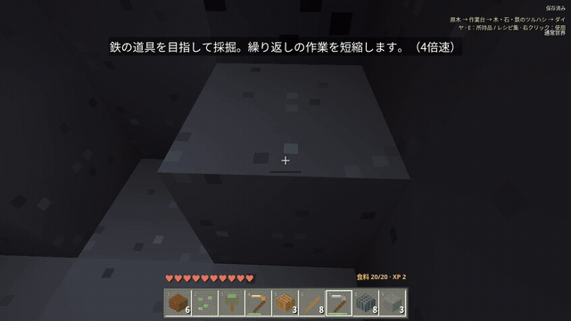

# 所持品ゼロからドラゴン討伐：新しいサバイバルの字幕実況

上のGIFは本編の抜粋を自動ループします。画像を押すと、ダウンロードせずに本編を連続・ループ再生できます。

2026年10月31日（日本時間）に開始した新規セーブ（シード2026）で、所持品ゼロからドラゴン討伐・卵の入手・通常世界への帰還まで進めたプレイです。途中の死亡2回と装備の回収も含め、流れが分かるよう合計14分56秒に編集しました。

**日本語字幕・三人称・720p。** 本編ページでは全章を自動で連続再生できます。保存する場合は番号順にご覧ください。字幕は焼き込み済みなので、MP4だけでも再生できます。採掘・移動・待ち時間にはカットと早送りを使い、主要な戦闘は等速を中心に残しています。

| 順番 | 章                                           | 時間    | 容量   | ダウンロード                                                                                                                          |
| ---- | -------------------------------------------- | ------- | ------ | ------------------------------------------------------------------------------------------------------------------------------------- |
| 1    | 道具づくりと最初の戦闘                       | 5分14秒 | 約71MB | [MP4をダウンロード](https://github.com/temesotejam/2026_10_24_2/raw/refs/heads/main/downloads/edited-survival/survival-edited-01.mp4) |
| 2    | 自作ゲート・失敗からの回収・ネザー遠征       | 4分03秒 | 約42MB | [MP4をダウンロード](https://github.com/temesotejam/2026_10_24_2/raw/refs/heads/main/downloads/edited-survival/survival-edited-02.mp4) |
| 3    | 食料の立て直し・パール集め・エンドへの準備   | 3分20秒 | 約41MB | [MP4をダウンロード](https://github.com/temesotejam/2026_10_24_2/raw/refs/heads/main/downloads/edited-survival/survival-edited-03.mp4) |
| 4    | クリスタル破壊・ドラゴン討伐・卵を持って生還 | 2分20秒 | 約20MB | [MP4をダウンロード](https://github.com/temesotejam/2026_10_24_2/raw/refs/heads/main/downloads/edited-survival/survival-edited-04.mp4) |

合計約173MB。CRF18・ビットレート上限なしで出力し、容量に応じて章を分けています。

[ダウンロードせず再生する](https://temesotejam.github.io/2026_10_24_2/watch/edited.html) / [編集箇所・クリア結果・各ファイルのSHA-256](./edit-proof.json)

操作スクリプトが、観測用の地図と通常のキー・マウス操作を使ってプレイしています。エンダーアイによる方向確認の後、地図で遺跡までの経路を選んでいます。録画時の描画倍率は100％です。音声はなく、実況は字幕です。

討伐後に帰還ゲートの不具合が見つかったため、ゲームを修正して同じ通常セーブから帰還を再試行しました。卵・所持品・体力を引き継いで、設定済みのベッド地点へ生還しています。最終章の字幕でも説明しています。
